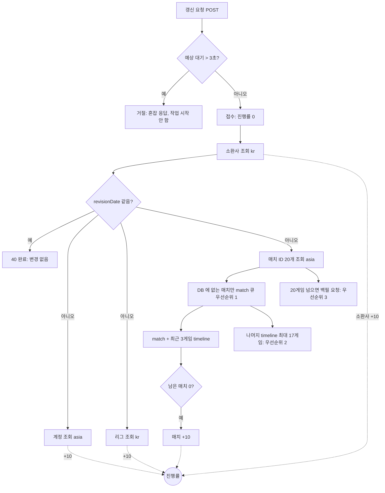

# 전적 갱신 파이프라인 재설계

- 작성일: 2026-10-27
- 범위: lol-repository (갱신 API · 갱신 파이프라인 · Riot 호출 한도 관리), lol-ui (갱신 버튼 · 상태 폴링)
- 상태: 설계 (구현 전)
- 표기: **[결정]** 은 사용자가 정한 것, **[판단]** 은 설계 작성자가 정한 것으로 빌더가 더 나은 근거가 있으면 바꿀 수 있다.

## 1. 왜 바꾸나

### 지금 구조

- 갱신 컨슈머 `SummonerRenewalListener`(동시 20)가 메시지 하나 안에서 소환사 조회 → revision 비교 → 계정·리그 조회 → 매치 ID 20개 조회 → 새 매치의 match + timeline 을 **모두 동기로 기다린다** (`SummonerRenewalService`).
- 그 안의 Riot 호출 하나만 실패해도 `join()` 에서 예외가 나 그 갱신의 매치·소환사 저장이 통째로 빠진다.
- 갱신 상태는 Redis `summoner:renewal:{puuid}` 의 존재 여부 하나뿐이다 (TTL 2분). 진행 정도는 알 수 없다.
- Riot 한도는 Redisson `RRateLimiter` 두 개(`RateLimitType`: regional 460/10s, platform 450/10s)로 고정값이다. 토큰을 3초 안에 못 받으면 로컬 429 예외 → `RetryInterceptor` 가 재시도 → 결국 실패한다. `setRate` 가 재시작 때마다 사용 이력을 지워(Redisson 3.46 Lua `del`) 배포 직후 10초 안에 한도의 두 배까지 나갈 수 있다.
- 20게임 이후 백필(`MatchFindListener` → `mmrtr.matchId` → `MatchListener`)이 같은 버킷을 우선순위 없이 나눠 쓴다. `MatchDataProcessor` 는 매치당 토큰 1개(20/s)를 잡지만 실제 호출은 match + timeline 2회라 asia 예산 46/s 중 40/s 를 쓴다. (PR #130 이 이 리스너들을 켠다.)
- 운영 lol-ui(`1.13.0-eb83947`, MP-174)는 이미 lol-repository 의 `POST/GET /api/v1/summoners/{puuid}/renewal` 을 쓴다. POST 응답 `status` 가 `FAILED` 면 쿨다운 문구를 띄우고, 아니면 1초 고정 간격으로 최대 10초 GET 을 폴링하다가 `status` 가 `PROGRESS` 가 아니게 되면 데이터를 다시 불러온다 (`ProfileSection.tsx`). 진행 정도는 모른다.
- 사용자 갱신 말고도 같은 `mmrtr.summoner` 큐로 갱신 메시지가 들어온다. 관리자 티어 수집(`AdminTierCollectionController` → `TierCollectionService`)이 EMERALD 이상 페이지의 puuid 를 대량으로, lol-server(`SummonerMessageAdapter`)가 자기 갱신 엔드포인트 요청을 같은 큐에 넣는다.

### 바꾸는 이유

- 초당 10건의 갱신 요청이 몰려도 Riot 429 가 나지 않아야 한다.
- 갱신을 계정(닉네임)·소환사·리그·매치 4단계 비동기 작업으로 나누고, 단계마다 진행률을 올려 유저에게 보여 주고 싶다. **[결정]**
- 감당할 수 없는 양은 유저를 오래 기다리게 하지 말고 즉시 "잠시 후 다시 시도해 주세요" 로 돌려보낸다. **[결정]**

## 2. 목표 · 비목표 · 안티목표

### 목표

- **G1. Riot 429 = 0.** application·method 한도 기준. (service 한도 429 는 Riot 쪽 사정이라 0 을 보장할 수 없지만 대응은 한다 — 6.4)
- **G2. 접수된 갱신은 3초 안에 40 에 닿는다.** **[결정]**
- **G3. 3초 안에 못 끝낼 게 보이면 접수하지 않고 즉시 거절**하고, 화면에는 "잠시 후 다시 시도해 주세요" 를 띄운다. **[결정]**
- **G4. 20게임 이후 백필은 갱신을 늦추지 않는다.** 갱신이 쓰고 남은 예산만 쓴다. **[결정]**
- **G5. 한도 값은 Riot 응답 헤더로 배우고, Riot 이 바꾸면 바로 따라간다.** **[결정]**

### 비목표

- 초당 10건의 **첫 갱신(새 게임 20개)** 을 전부 3초 안에 처리하는 것. 예산상 불가능하다(4장). 넘치는 몫은 G3 로 처리한다.
- API 키를 여러 개 써서 한도를 늘리는 것 (Riot 정책 위반).
- lol-server 의 갱신 엔드포인트 정리. lol-ui 가 lol-repository 로 옮긴 뒤 별도 작업으로 한다.
- 20게임 이후 백필의 수집 범위(`MatchFindService` 의 startTime 하한, 페이지 수) 변경.

### 안티목표 — 돌아가더라도 실패로 본다

- 40 을 보고 상세 페이지를 다시 불렀는데 **최근 20게임이 목록에 없다.**
- 접수된 갱신이 3초를 넘겼다는 이유로 **서버에서 버려진다.** (화면은 문구를 띄우지만 서버는 끝까지 처리해야 한다)
- **백필 때문에 갱신이 느려진다.**
- 배포·재시작 순간 **한도 기록이 초기화되어 429 가 난다.**
- 메시지 재전달로 **진행률이 두 번 올라 40 을 넘거나, 덜 끝났는데 40 이 된다.**

## 3. 제약

- **Riot 한도는 routing value 마다 따로다.** 플랫폼 호스트(kr 등)와 지역 호스트(asia 등)는 별개 버킷이다.
  - 갱신의 asia 호출: account 1 + matchIds 1 + match N + timeline min(N, 3)
  - 갱신의 kr 호출: summoner 1 + league 1
- **한도 형식:** 응답 헤더 `X-App-Rate-Limit: 500:10,30000:600`, `X-Method-Rate-Limit: 2000:10` (창이 여러 개일 수 있다). 현재 사용 수는 `X-App-Rate-Limit-Count`, `X-Method-Rate-Limit-Count`. 429 응답에는 `Retry-After` 와 `X-Rate-Limit-Type`(application / method / service).
- **인스턴스가 여러 개일 수 있다.** 한도 카운트와 학습한 한도 값은 Redis 에 두고 모든 인스턴스가 공유한다.
- **운영 Riot API 키는 운영 lol-repository 파드에서만 쓴다.** **[결정]** 로컬 개발·도구는 별도 개발 키를 쓴다. 그래서 운영 Redis 카운터가 운영 키 사용량 전부를 본다는 전제가 성립한다.
- **기존 인프라를 그대로 쓴다:** RabbitMQ, Redis(Redisson 3.46), PostgreSQL, Spring Boot 3.5.9 / spring-web 6.2.15. **[결정]** spring-web 6.2.15 는 `RestClient...attribute(name, value)` 와 인터셉터의 `HttpRequest#getAttributes()` 를 지원한다(확인함) — 호출마다 우선순위를 실어 보낼 수 있다.
- **매치 목록 API 의 읽기 경로:** `MatchQueryService#getSummonerMatches` 는 DB 결과에 Redis 캐시를 얹는다. 캐시는 `match:ids:v1:{요청자 puuid}`(ZSET, 20개, TTL 3분)와 `match:v1:{matchId}`(GameReadModel JSON, timeline 에서 뽑은 itemSeq/skillSeq 포함, TTL 3분). 타임라인 상세(`getTimeline`)는 **DB 만** 읽는다.
- **매치 저장 경로:** `SaveMatchDataUseCase` → `MatchService#saveAll(matches, timelines, leagueMap)`. timelines 가 비어 있으면 매치만 저장한다. **타임라인만 나중에 따로 저장하는 경로는 없다** (`TimeLineService#saveAll` 이 매치 엔티티를 함께 받는다).
- **갱신 요청 입구 규칙은 유지한다** (`SummonerRenewalRequestService`): DB 에 없는 소환사는 `NOT_FOUND_PUUID`, 진행 중이면 중복 접수하지 않음, 클릭 쿨다운 10초, 마지막 Riot 호출 후 2분 쿨다운.
- **공개 API 규약:** `@PublicApi` + `ApiResponse<T>`, 소유 prefix `/api/v1/summoners`, RestDocs 테스트로 응답 필드 검증 (CLAUDE.md "공개 API · 포트 분리").
- **운영 중인 lol-ui 계약을 깨지 않는다.** 배포된 UI 는 POST `status == "FAILED"` 를 거절로, GET `status != "PROGRESS"` 를 완료로 읽는다. 백엔드와 UI 의 배포 순서와 상관없이 동작해야 한다 (6.7).
- **lol-server 는 Redis `summoner:renewal:{puuid}` 를 문자열로 읽는다.** 같은 키의 타입을 바꾸면 lol-server 에서 WRONGTYPE 오류가 난다 (6.1).
- **PR #130(아직 미머지)과 함께 간다.** #130 이 `MatchFindListener`·`MatchListener` 를 켠다. 이 설계가 그 백필 흐름을 우선순위 3 으로 편입하므로, #130 을 먼저 머지하거나 이 작업에 흡수한다 (빌더 판단).

## 4. 용량 계산

asia 예산을 500/10s 로 가정하면 초당 45회(10% 여유), 3초 동안 135회다.

| 갱신 종류 | asia 호출 | 3초(135회) 안에 받을 수 있는 건수 |
|---|---|---|
| 첫 갱신 (새 게임 20) | 2 + 20 + 3 = 25 | 약 5 |
| 새 게임 3 | 2 + 3 + 3 = 8 | 약 16 |
| 새 게임 1 | 2 + 1 + 1 = 4 | 약 33 |
| 변경 없음 (revision 같음) | 0 (kr 1회) | asia 제한 없음 |

초당 10건이 모두 첫 갱신이면 asia 250 req/s 가 필요해 예산의 5배를 넘는다. 그래서 G3(접수 거절)가 필요하다. 실제 평균 새 게임 수는 로그 `[갱신-API] fetchNewMatchIds ... count=` 로 측정할 수 있다.

## 5. 결정된 설계

### 5.1 진행률 모델 [결정]

- 단계는 **계정(닉네임) · 소환사 · 리그 · 매치** 4개다.
- 단계가 하나 끝날 때마다 **+10**. 끝나는 순서와 상관없이 **40 = 전부 끝남**이다.
- 단계는 서로 기다리지 않고 동시에 돈다. 예외는 5.2 의 "소환사 먼저 확인" 하나다.
- 진행률은 Redis 에 갱신 단위로 저장한다.
- **매치 단계의 완료 =** 이번 갱신의 새 매치(최근 20게임 중 DB 에 없는 것)가 전부 처리되어 **매치 목록 API 에 보이는 시점**. 새 매치가 없으면 바로 완료다.
- 어떤 단계가 Riot 오류로 끝내 실패하면 진행률 대신 **실패** 상태가 된다. 실패한 단계만 골라 다시 하지 않는다.

### 5.2 갱신 흐름 [결정]

1. **접수.** 지금 밀려 있는 호출량으로 예상 대기를 계산해 3초를 넘으면 **거절**한다. 작업을 시작하지 않으므로 다른 갱신의 예산을 지킨다.
2. **소환사 먼저.** 소환사 조회(kr 1회)를 먼저 하고, DB 의 revisionDate 와 같으면 곧장 40 으로 끝낸다. 2분 쿨다운 직후의 갱신은 대부분 여기서 끝나 asia 예산을 쓰지 않는다.
3. **나머지 동시 실행.** 바뀐 게 있으면 계정·리그·매치 목록을 동시에 시작한다.
4. **매치.** 최근 20게임 ID 중 DB 에 없는 것만 match 큐 **우선순위 1** 로 넣고 남은 수를 센다. 0 이 되면 매치 단계 완료.
5. **타임라인.** 새 매치 중 **가장 최근 3게임**의 타임라인만 40 전에(우선순위 1) 받는다. 나머지 최대 17게임의 타임라인은 40 이후 **우선순위 2** 로 처리한다. 새 매치가 3개 이하면 전부 40 전에 받는다.
6. **백필.** 20게임 이후 매치는 지금처럼 백필 요청을 발행하고, match 큐 **우선순위 3** 으로 처리한다.
7. **접수된 갱신은 3초를 넘겨도 서버가 끝까지 처리한다.** 유저가 다시 눌렀을 때 결과가 보이게 하기 위해서다.

### 5.3 Riot 호출 한도 관리 [결정]

- **모든 Riot 호출**은 한도 관리자를 거친다.
- 버킷은 **(routing value) × (app | method)** 마다 둔다. 한 호출은 그 routing value 의 app 버킷과 해당 method 버킷을 **둘 다** 통과해야 나간다.
- **초 단위로 카운트한다.** 초당 허용치 = `floor(한도 × 0.9 ÷ 창 길이(초))`. 예: 300/10s → 27/s. 창이 여러 개면(10초 창과 10분 창) 가장 작은 값을 쓴다.
  - 근거: 1초 칸 10개의 합이 한도의 90% 이하이므로, Riot 의 10초 창이 칸 11개에 걸쳐도 99% 를 넘지 않는다.
- **한도 값은 응답 헤더에서 읽어 캐싱한다.** Riot 이 바꿀 수 있다고 가정하고, 응답마다 헤더를 보고 값이 달라졌으면 바로 바꾼다. 헤더를 아직 못 본 버킷은 설정 파일의 보수적 기본값을 쓴다.
- **match 큐는 한도 속도에 맞춰 소비한다.**

### 5.4 match 큐 우선순위 [결정]

| 우선순위 | 내용 | 언제 |
|---|---|---|
| 1 | 갱신 중인 매치: match + 최근 3게임 timeline | 40 전 |
| 2 | 갱신 뒤 나머지 timeline (최대 17게임) | 40 후 |
| 3 | 20게임 이후 백필 (match + timeline) | 남는 예산 |

- 위 우선순위의 일이 있으면 아래는 토큰을 가져가지 않는다. 위가 비면 아래가 예산 전체를 쓴다(밤 시간 백필이 쓸데없이 묶이지 않게).
- 사용자 갱신 단계의 호출(계정·소환사·리그·매치 목록)과 공개 API 의 동기 호출(소환사 검색, 관전 조회)은 우선순위 1 과 같은 등급이다. 사용자 클릭이 아닌 갱신(티어 수집 등)의 호출은 우선순위 3 이다 (6.10). **[판단]**

### 5.5 lol-ui [결정]

- **버튼이 곧 진행 바다 (목업 B안).** 버튼 배경이 왼쪽부터 진행률만큼 차오르고(10/20/30/40 → 25/50/75/100%), 라벨은 `갱신 중 NN%`. 차오르는 동안 버튼은 눌리지 않는다.
- **40 이 되면** 버튼이 꽉 찬 상태로 `방금 갱신됨` 을 보여 주고, 상세 페이지의 API 들을 다시 불러온다 (지금처럼 react-query `invalidateQueries`).
- **폴링**은 갱신을 누르는 순간 시작하고, 1초부터 지수 백오프처럼 간격을 늘린다. 기다리는 시간은 **최대 3초**다.
- **3초 초과 · 접수 거절 · 실패** 면 버튼을 원래대로 돌리고 `잠시 후 다시 시도해 주세요` 를 띄운다.
- lol-ui 는 지금처럼 **lol-repository 공개 API** `POST/GET /api/v1/summoners/{puuid}/renewal` 을 쓰되, 응답에 새로 생기는 `state`·`progress` 를 읽는다 (6.7).

## 6. 빌더에게 맡기는 것 (작성자 판단 포함)

### 6.1 진행률 저장 [판단]

- **새 키** Redis hash `summoner:renewal:v2:{puuid}` 에 `status`, `steps`(완료 단계 비트마스크: 계정 1, 소환사 2, 리그 4, 매치 8), `remainingMatches`, `startedAt` 을 둔다. lol-server 가 문자열로 읽는 기존 키 `summoner:renewal:{puuid}` 는 타입을 바꾸지 않는다 (3장).
- 진행률 = `10 × (steps 의 켜진 비트 수)`. 비트로 세므로 메시지가 다시 와도 두 번 오르지 않는다 (안티목표).
- 단계 완료와 `remainingMatches` 감소는 Lua 로 원자적으로 처리한다. 같은 매치가 두 번 처리돼도 한 번만 줄도록 "이번 갱신에서 처리한 matchId" 집합을 함께 둔다.
- 상태 값: `PROGRESS`, `DONE`, `FAILED`. TTL 은 진행 중 동안 넉넉히(예: 5분), 끝나면 짧게(예: 30초) 남겨 마지막 폴링이 결과를 받게 한다. 기존 `RENEWAL_TTL` 2분은 이 구조로 대체한다.
- "소환사 먼저 확인"에서 변경이 없으면 4단계를 한 번에 완료 처리한다.

### 6.2 단계가 "끝났다"의 기준 [판단]

- 각 단계는 **자기 데이터가 화면에 보이게 된 뒤** +10 한다. 계정·소환사·리그는 DB 저장 후, 매치는 매치 목록 캐시(`match:v1`, `match:ids:v1:{요청자}`)에 쓴 뒤.
- 지금 `SummonerAssembler` 는 계정·리그·소환사를 한꺼번에 조립해 저장한다. 단계별로 따로 저장할 수 있게 나누거나, 셋이 모두 끝났을 때 함께 저장하고 세 비트를 같이 켜도 된다(진행률이 0 → 30 처럼 한 번에 뛰는 것은 허용).
- 매치 목록 캐시 TTL 이 3분이므로 그 안에 DB 일괄 저장이 끝나야 한다 (지금 구조와 같음).

### 6.3 접수 판단 (예상 대기) [판단]

- POST 처리 중에 "asia 버킷에 우선순위 1 로 이미 잡혀 있는 호출 수 + 이번 갱신의 최악 비용(25회)" 을 초당 허용치로 나눠 3초를 넘으면 거절한다.
- 처음에는 최악 비용으로 보수적으로 시작하고, 실측한 평균 새 게임 수로 다듬어도 된다.
- 거절 응답은 HTTP 200 + 상태 `BUSY` (아래 6.7).

### 6.4 한도 관리자 구현 [판단]

- Redisson `RRateLimiter`(`RateLimitInterceptor`, `ListenerRateLimiterConfig`, `RateLimitType`) 를 걷어내고, Lua 스크립트 하나로 "모든 해당 버킷 확인 → 전부 여유 있으면 함께 증가" 를 원자적으로 한다.
- 키 예: `riot:rl:{routing}:{app|method명}:{epochSecond}`, TTL 2초. 학습한 한도 값: `riot:rl:limits:{routing}:{app|method명}`.
- 이번 초가 차 있으면 **다음 빈 초를 예약**하고 대기 시간을 돌려준다. 호출부는 그만큼 기다렸다 보낸다. 우선순위 1 은 예약할 수 있고, 2·3 은 **이번 초에 자리가 있을 때만** 가져가며 미래 칸을 예약하지 않는다(위 우선순위 자리를 뺏지 않게).
- "위 우선순위의 일이 있으면 아래는 토큰을 못 가져간다"는 우선순위별 활동 표시 키(예: 최근 1초 내 우선순위 1 요청이 있었는지)로 판단한다.
- 우선순위는 RestClient `attribute("riot.priority", …)` 로 실어 보내고 인터셉터가 읽는다.
- method 이름은 엔드포인트 템플릿 단위로 정한다 (예: `match-v5.matches.byId`, `match-v5.timeline`).
- **429 를 받으면** `Retry-After` 동안 해당 버킷을 Redis 키로 전역 정지시켜 모든 인스턴스가 함께 멈춘다. `X-Rate-Limit-Type` 을 메트릭 태그로 남긴다. 로컬 한도 대기는 `RetryInterceptor` 의 재시도 대상에서 뺀다.
- 헤더를 못 본 상태의 기본값은 설정 파일에 둔다 (운영 키 값). 학습한 값은 TTL 없이 두되 응답마다 다르면 덮어쓴다.
- **안전망:** 운영 키는 운영 파드만 쓰지만(3장), Redis 카운터가 놓칠 수 있는 사용량(Redis 장애·재시작 직전의 호출, 카운터 키 유실)을 흡수하기 위해 응답의 `X-App-Rate-Limit-Count`·`X-Method-Rate-Limit-Count` 도 읽는다. 어떤 창의 사용량이 그 창 한도의 90% 이상이면 해당 버킷의 남은 칸을 비워(또는 잠시 정지해) 더 보내지 않는다.

### 6.5 match 큐 [판단]

- RabbitMQ 우선순위 큐(`x-max-priority: 3`) 하나로 해도 되고 큐 세 개로 나눠도 된다. 우선순위 큐는 prefetch 로 이미 넘어간 메시지에는 우선순위가 적용되지 않으므로 prefetch 를 작게 둔다.
- 메시지에는 matchId, platform, 우선순위, (우선순위 1·2 면) 요청자 puuid 와 "타임라인 포함 여부"를 싣는다. 요청자 puuid 는 캐시 ZSET 에 넣고 `remainingMatches` 를 줄이는 데 쓴다.
- 우선순위 3 메시지는 오래 기다릴 수 있다. RabbitMQ consumer timeout(기본 30분)에 걸리지 않도록 토큰 대기에 상한을 두고 넘으면 requeue 한다.
- 지금의 `MatchDataProcessor`/`MatchBatchProcessor`/`globalApiRateLimiter` 구조는 이 큐 소비자로 대체한다.

### 6.6 나중에 오는 타임라인 [판단]

- 타임라인만 따로 저장하는 경로를 새로 만든다 (현재 `MatchService#saveAll` 은 매치 엔티티와 함께만 저장).
- 타임라인이 저장되면 캐시의 `match:v1:{matchId}` 가 아직 살아 있을 때 itemSeq/skillSeq 를 채워 다시 쓴다. 캐시가 이미 만료됐으면 DB 가 원천이므로 할 일 없다.
- 상세 화면은 타임라인이 아직 없으면 그래프·빌드 순서를 비워 둔다 (응답 모델이 이미 null 을 허용한다).

### 6.7 API 계약 [판단]

운영 중인 lol-ui 를 깨지 않도록 **기존 `status` 는 그대로 두고 필드를 추가**한다. 배포 순서를 맞출 필요가 없다.

| 엔드포인트 | 새 `state` | 기존 `status` (구 UI 용) | HTTP | `progress` |
|---|---|---|---|---|
| POST | `ACCEPTED` 새로 접수 / `IN_PROGRESS` 이미 진행 중 | `SUCCESS` | 202 | 현재 값 |
| POST | `BUSY` 혼잡 거절 / `COOLDOWN` 쿨다운 / `DONE` 직전 갱신이 이미 끝남 | `FAILED` | 200 | 없음 |
| GET | `PROGRESS` / `DONE` / `FAILED` | `PROGRESS` / `SUCCESS` / `SUCCESS` | 200 | 0~40 |

- 구 UI 는 `BUSY`·`DONE` 도 쿨다운 문구로 보이지만 폴링에 빠지지 않는다. 새 UI 배포까지의 과도기로 받아들인다.
- 새 UI 는 `state`·`progress` 만 본다. 3초를 넘겨 문구를 본 유저가 다시 누르면, 진행 중이면 폴링을 이어 가고 `DONE` 이면 바로 데이터를 다시 불러온다. 쿨다운 안에 끝난 갱신을 "쿨다운 오류" 로 보여 주지 않기 위해서다.
- RestDocs 테스트와 lol-ui 타입(`SummonerRenewalResponse`)에 새 필드를 추가한다.

### 6.8 lol-ui 세부 [판단]

- 폴링 간격: 1초 후 첫 폴링, 이후 간격을 늘리되 3초 상한 안에서 끝낸다 (실제로는 2~3번). 진행 바는 CSS transition 으로 부드럽게 채운다.
- 오류 문구는 지금처럼 5초 뒤 사라진다.
- 기존 `cooldownInfo`(마지막 갱신 시각 기반 비활성)는 유지한다.

### 6.9 동시성 · 실패 [판단]

- 갱신 컨슈머 동시 수는 예산이 감당하는 만큼만 둔다. 대기는 Redis 가 아니라 RabbitMQ 큐(FIFO)에서 하게 한다.
- 계정·소환사·리그·매치 목록 단계는 컨슈머 안에서 비동기로 돌린다. 매치만 match 큐를 거친다.
- 단계 실패(재시도 소진) 시 `FAILED` 로 바꾸고 나머지 단계 결과는 저장된 대로 둔다.

### 6.10 사용자 클릭이 아닌 갱신 메시지 [판단]

- 사용자 갱신은 **새 큐**(예: `mmrtr.renewal.user`)와 새 메시지(갱신 id, 출처 포함)로 옮긴다. 진행률 레코드·접수 판단·우선순위 1 은 이 큐에만 적용한다.
- 기존 `mmrtr.summoner` 큐는 그대로 두고 **백그라운드(우선순위 3)** 로 소비한다. 관리자 티어 수집의 대량 발행과 lol-server 발행이 여기에 남는다. 진행률 레코드를 만들지 않고, 접수 판단의 "밀린 호출량"에도 넣지 않는다.
- 이렇게 하면 티어 수집이 도는 동안에도 사용자 갱신이 그 뒤에 줄 서지 않는다 (G2·G3).

### 6.11 관측 · 검증

- 메트릭: 버킷별 사용량과 허용치, 토큰 대기 시간, 접수 거절 수, 429 수(`X-Rate-Limit-Type` 별), 접수→40 시간 분포, 우선순위별 큐 깊이.
- 부하 검증: "10초 창에서 500회를 넘으면 429" 를 내는 WireMock Riot stub 을 두고 초당 10건 갱신을 60초 보낸다. 통과 기준은 429 = 0, 접수된 갱신의 40 도달 p95 ≤ 3초, 거절은 즉시 응답.
- 재시작 검증: 부하 중 인스턴스를 재시작해도 429 가 나지 않아야 한다.
