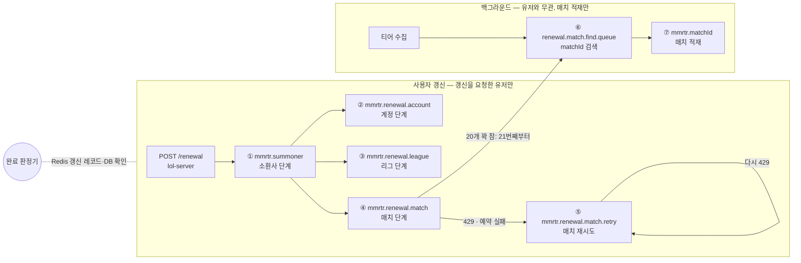

# 전적 갱신 완료 판정과 이벤트 큐 (Plan 2 기반 작업)

- 작성일: 2026-11-03
- 범위: lol-repository (갱신 리스너·큐 · 매치 처리 · 갱신 상태 API · 티어 수집 경로 · 실험실 지표)
- 상태: 설계 (구현 전)
- 선행 문서: `2026-10-27-summoner-renewal-pipeline-design.md` (이하 "Plan 2 설계"), `2026-11-01-riot-api-lab-design.md` (이하 "실험실 설계")
- 표기: **[결정]** 은 사용자가 정한 것, **[판단]** 은 설계 작성자가 정한 것으로 빌더가 더 나은 근거가 있으면 바꿀 수 있다.

## 1. 왜 하나

### 지금 구조

- 갱신 상태는 Redis `summoner:renewal:{puuid}` 의 존재 여부 하나다. 갱신 리스너(`SummonerRenewalListener`)가 끝나면 finally 에서 지운다. 실패해도 지우므로 상태 GET 은 `SUCCESS` 를 돌려준다.
- `SummonerRenewalService.doRenew` 가 메시지 하나 안에서 summoner → account ∥ league → match ids → match·timeline ×N 을 모두 기다린다. 호출 하나만 실패해도 `join()` 예외로 아무것도 저장되지 않는다.
- 소환사는 Riot 의 새 revisionDate 로 저장되는데, 매치 DB 저장(`AsyncMatchSaver`)은 그 뒤에 비동기로 돈다. 비동기 저장이 실패하면 커서(DB revisionDate = 다음 갱신의 match ids `startTime`)는 이미 앞으로 가 있어 그 매치는 다시 조회되지 않는다.
- 티어 수집(`TierCollectionService`)이 사용자 갱신과 같은 `mmrtr.summoner` 큐에 `background=true` 메시지를 넣고, 갱신 리스너가 그 값으로 USER/BACKGROUND 를 나눈다. 백그라운드 수집이 사용자 갱신 리스너를 함께 쓴다.
- 중복 방지는 백필 경로만 한다(`match:pending`, `match:processing`). 갱신 경로는 DB 만 본다. 같은 판의 두 유저가 동시에 갱신하면 같은 매치를 둘 다 Riot 에 요청한다.
- 429 를 받으면 `RetryInterceptor` 가 그 스레드에서 Retry-After(±25%)만큼 잔 뒤 다시 보낸다(최대 3번 시도). 20건을 병렬로 보내다 여러 건이 429 를 받으면 비슷한 시점에 한꺼번에 다시 보내고, 그동안 갱신이 묶인다.
- 매치 관련 INSERT 는 모두 `ON CONFLICT DO NOTHING` 이다. 중복 처리는 데이터 문제가 아니라 Riot 예산(매치당 asia 2회) 낭비다.

### 바꾸는 이유

- 상태 GET 이 `SUCCESS` 를 돌려주는 순간은 **갱신해야 할 모든 것이 끝난 순간**이어야 한다. **[결정]**
- 사용자 응답은 **최대 5초**다. 넘으면 `FAILED` 와 "잠시 후 다시 시도해 주세요" 를 돌려주고, 서버는 뒤에서 일을 이어 간다. **[결정]**
- **리스너마다 맡은 일은 하나이고, 다른 리스너의 동작에 영향을 주지 않는다.** 사용자 갱신 쪽 큐에는 갱신을 요청한 유저의 메시지만 들어가고, 백그라운드 수집은 누구의 갱신인지 모른 채 매치를 적재하기만 한다. **[결정]**
- Plan 2(진행률 10/20/30/40, 접수 거절)는 이 단계 구조 위에 올라간다. 단계와 완료 판정을 먼저 만들어 두면 Plan 2 는 진행률을 보여 주고 접수를 판단하는 일이 된다.

## 2. 목표 · 비목표 · 안티목표

### 목표

- **G1. 상태 GET 의 `SUCCESS` 는 아래가 전부 끝났을 때만이다.** **[결정]**
  1. 소환사 조회 (revisionDate 비교)
  2. 계정 조회 → DB 저장
  3. 리그 조회 → DB 저장
  4. 매치 ID 조회 (최근 20개)
  5. 새 매치마다 매치 상세 + 타임라인 → DB 저장
  - revisionDate 가 같으면 1 에서 바로 `SUCCESS` 다.
- **G2. 접수부터 5초 안에 끝나지 않으면 `FAILED` 와 "잠시 후 다시 시도해 주세요" 를 돌려준다.** 실패한 단계가 있어도 `FAILED`, 진행 중이면 `PROGRESS` 다. 상태 GET 은 이 셋을 돌려준다. **[결정]**
- **G3. `FAILED` 뒤에도 서버는 그 갱신의 일을 끝까지 한다.** 유저가 다시 눌렀을 때 결과가 보이게 하기 위해서다. **[결정]** (Plan 2 설계 5.2-7 과 같다)
- **G4. 갱신 단계마다 큐와 리스너가 따로 있고, 리스너는 서로의 동작을 바꾸지 않는다.** 사용자 쪽과 백그라운드 쪽이 만나는 곳은 Riot 예산(한도 관리자)과 DB 두 군데뿐이다. **[결정]**
- **G5. 사용자 갱신끼리 같은 매치를 Riot 에 두 번 요청하지 않는다.** Riot 호출 전에 DB 와 Redis 를 확인한다. **[결정]**
- **G6. 갱신의 매치 호출은 429 를 인라인으로 재시도하지 않는다.** 429 받은 매치는 따로 빼서 다시 처리한다. **[결정]**
- **G7. 사용자 쪽 리스너는 DB 에 쓴 뒤에 ack 한다.** 처리 중에 프로세스가 죽어도 메시지가 다시 와서 일이 사라지지 않는다. **[결정]**
- **G8. 사용자 갱신 때문에 매치가 영구히 빠지지 않는다.** 커서는 모두 끝났을 때만 옮긴다.

### 비목표

- 진행률(10/20/30/40) 노출, 접수 거절(`BUSY`), 타임라인 나중 받기. 모두 Plan 2 다. 단계 비트는 이번에 만들지만 응답에 진행률로 내보내지 않는다. **[결정]**
- 20게임 이후 매치의 완료 판정. 백그라운드가 적재하며 `SUCCESS` 와 상관없다. **[결정]**
- 사용자 쪽과 백그라운드 쪽 사이의 중복 방지. 둘은 처리 표시를 공유하지 않는다 (G4). 같은 매치를 둘 다 부를 수 있고, DB 는 `ON CONFLICT` 로 하나만 남긴다. **[결정]**
- 백그라운드 매치 적재(`MatchListener`)의 ack 시점 변경. 지금처럼 메모리 배치 큐에 넣은 뒤 ack 한다. **[판단]**
- 기한이 지난 갱신의 남은 호출 우선순위 낮추기. 이번에는 끝까지 USER 로 돈다 (8장 한계). **[판단]**
- lol-server · lol-ui 코드 변경.

### 안티목표 — 돌아가더라도 실패로 본다

- 대상 매치 중 하나라도 DB 에 없는데 `SUCCESS` 다.
- 5초를 넘겼는데 `PROGRESS` 를 돌려준다.
- 백그라운드 수집의 상태(처리 중, 실패 등)가 사용자 갱신의 결과나 순서를 바꾼다. 또는 그 반대.
- 같은 판의 두 유저가 동시에 갱신했는데 같은 매치를 둘 다 Riot 에 요청한다.
- 429 하나 때문에 갱신 전체가 Retry-After 동안 묶이거나, 429 받은 호출이 한꺼번에 다시 나간다.
- lol-server 가 깨지거나(WRONGTYPE 등), 배포된 lol-ui 가 깨진다.
- 메시지 재전달이나 인스턴스 여러 대 때문에 완료 지표가 두 번 세지거나, 끝난 상태가 `SUCCESS` ↔ `FAILED` 로 뒤집힌다.
- 지난 갱신의 메시지나 실패 표시가 새 갱신의 결과를 정한다.

## 3. 제약

- **lol-server 는 `summoner:renewal:{puuid}` 를 문자열로 읽는다** (`SummonerCacheAdapter.isUpdating`, `getRefreshingPuuids` 의 키 스캔). 키 이름·타입·값(puuid)을 바꾸지 않는다. lol-server 도 같은 키를 TTL 2분으로 만들고 같은 `mmrtr.summoner` 큐(`mmrtr.exchange` / `mmrtr.key`)에 사용자 갱신 메시지를 넣는다. lol-server 가 만든 메시지에는 갱신 id 가 없다.
- **새 Redis 키는 `summoner:renewal:*` 패턴 밖에 둔다.** lol-server `getRefreshingPuuids` 가 이 패턴을 SCAN 해 키 뒷부분을 puuid 로 읽는다. 지금은 부르는 곳이 없지만, 부르게 되면 뒷부분을 puuid 로 잘못 읽는다.
- **배포된 lol-ui:** POST `status == FAILED` 는 거절(쿨다운 문구), GET `status != PROGRESS` 는 끝(데이터 다시 불러오기)으로 읽는다. GET `FAILED` 도 구 UI 에서는 "끝" 으로 읽혀 문구 없이 데이터를 다시 불러온다. 깨지지 않는다. 문구를 화면에 띄우는 것은 lol-ui 몫이다.
- **컨텍스트 경계 (ArchUnit):** summoner 도메인은 match 도메인 port 에 의존하지 않는다. 매치 존재 확인이 필요한 완료 판정은 두 도메인에 이미 의존하는 `module:infra:rabbitmq` 에 둔다. 상태 GET 은 Redis 만 읽는다.
- **인스턴스가 여러 대일 수 있다.** 상태 전이와 단계 표시는 Redis 에서 원자적으로 한다.
- **공개 API 규약** (`@PublicApi`, `ApiResponse<T>`, RestDocs). HTTP 코드는 바꾸지 않는다. GET `status` 값의 의미가 바뀌고 문구 필드가 더해진다.
- **Riot 호출은 #135 한도 관리자를 그대로 쓴다.** 우선순위는 `RiotCallScope` 로 정하고, 한도 관리자가 Riot 호출을 내보낼 때만 쓴다(큐 순서와 무관). USER 는 10초 앞까지 칸을 예약하고 못 잡으면 `RiotBudgetExceededException`. 429 를 받으면 그 routing 버킷 전체가 Retry-After 동안 멈춘다.
- **`MatchService.saveAll` 의 커넥션 hold-and-wait** (실험실 PR #139 의 앱 문제 1): 트랜잭션 커넥션을 쥔 채 타임라인 저장(각자 커넥션 필요)을 기다린다. 실험실에서 약 10건이 겹치자 Hikari 풀(15)이 30초 멈췄다. G7 로 사용자 쪽 저장이 리스너 안에서 바로 일어나므로 **이번 범위에서 고친다**.
- **매치 목록 읽기 경로:** `MatchQueryService` 는 DB 결과에 요청자 캐시(`match:ids:v1:{puuid}`, `match:v1:{matchId}`, TTL 3분)를 덮어 보여 준다.
- **검증:** `./gradlew check` 통과, 실험실 `lab.sh run steady` 판정에 FAIL 없음.

## 4. 큐 정의

### 4.1 전체 그림

- 사용자 쪽에서 백그라운드 쪽으로 가는 길은 "20개를 꽉 채웠으면 21번째부터 찾아 달라" 는 넘김 하나뿐이다. 넘긴 뒤에는 결과를 기다리지 않는다.
- 백그라운드 쪽은 사용자 쪽 큐에 넣지 않는다.

### 4.2 큐마다 하는 일

| # | 큐 | 넣는 곳 | 받는 리스너 | 하는 일 | 우선순위 | ack |
|---|---|---|---|---|---|---|
| ① | `mmrtr.summoner` (기존) | lol-repository POST, lol-server | `SummonerRenewalListener` | **소환사 단계.** summoner-v4 조회 → revisionDate 비교. 같으면 `SUCCESS`. 다르면 소환사 정보 저장 → 소환사 비트 → ②③④ 발행 | USER | DB 저장·발행 뒤 |
| ② | `mmrtr.renewal.account` (새) | ① | 계정 리스너 | **계정 단계.** account-v1 조회 → 닉네임·태그 저장 → 계정 비트 | USER | DB 저장 뒤 |
| ③ | `mmrtr.renewal.league` (새) | ① | 리그 리스너 | **리그 단계.** league-v4 entries-by-puuid 조회 → 리그 정보 저장 → 리그 비트 | USER | DB 저장 뒤 |
| ④ | `mmrtr.renewal.match` (새) | ① | 매치 리스너 | **매치 단계.** match ids(커서 이후 20개) → DB 에 없는 대상 기록 → 선점한 대상의 match + timeline 을 병렬 조회 → DB 저장. 429·예약 실패는 ⑤ 로. 20개 꽉 차면 ⑥ 으로 넘김. 대상이 전부 DB 에 있으면 매치 비트 | USER | DB 저장 뒤 |
| ⑤ | `mmrtr.renewal.match.retry` (새) | ④, ⑤ | 매치 재시도 리스너 | **429 받은 매치를 1건씩 다시.** 한도 관리자의 429 정지가 끝난 뒤 나간다. DB 저장. 429 를 3번 받거나 4xx 면 실패 표시 → DLX | USER | DB 저장 뒤 |
| ⑥ | `renewal.match.find.queue` (기존, #130 이 켬) | 티어 수집(offset 0), ④(offset 20) | `MatchFindListener` | **matchId 검색.** puuid 의 match ids 를 100개씩 최대 10페이지 모아, DB·`match:pending` 확인 후 ⑦ 로 | BACKGROUND | 지금 그대로 |
| ⑦ | `mmrtr.matchId` (기존, #130 이 켬) | ⑥ | `MatchListener` | **매치 적재.** `match:processing` 선점 → match + timeline → 배치 저장 | BACKGROUND | 지금 그대로 (배치 큐에 넣은 뒤) |

- 새 큐 ②~⑤ 는 exchange `mmrtr.renewal.exchange`(direct) 하나에 routing key 로 묶고, 각자 DLX `<큐 이름>.dlx` 를 둔다. 이름은 **[판단]** 이다.
- 사용자 쪽 리스너 ②~⑤ 는 prefetch 1, 수동 ack. 동시 수는 설정값이다 (시작값: ② 10, ③ 10, ④ 20, ⑤ 4).
- 사용자 쪽 리스너는 Riot 호출 실패 중 429 와 예약 실패(`RiotBudgetExceededException`)를 인라인으로 재시도하지 않는다. ①②③ 은 자기 메시지를 같은 큐에 다시 넣고(시도 수 +1, 예약 실패는 세지 않음), ④ 는 그 매치만 ⑤ 로 보낸다. 5xx·IO 오류는 지금의 `RetryInterceptor` 인라인 재시도(최대 3번)를 그대로 쓴다. **[판단]**

### 4.3 메시지

| 큐 | 본문 |
|---|---|
| ① | `SummonerMessage` {platformId, puuid, revisionDate, background, **renewalId(새, 선택)**}. `background` 는 더 이상 읽지 않는다. lol-server 는 renewalId 를 보내지 않아도 된다 |
| ②③ | {renewalId, puuid, platform, attempt} |
| ④ | {renewalId, puuid, platform, startTime(DB revisionDate 초), attempt} |
| ⑤ | {renewalId, requesterPuuid, matchId, platform, attempt} |
| ⑥ | `SummonerRenewalMessage` {puuid, platform, revisionDate} + **startOffset(새, 없으면 20)** |
| ⑦ | 지금 그대로 (본문 matchId, 헤더 region) |

## 5. 설계

### 5.1 갱신 레코드 [판단]

- Redis hash `summoner:renewal-v2:{puuid}`. Plan 2 설계 6.1 의 `summoner:renewal:v2:{puuid}` 를 3장 이유로 `renewal-v2` 로 바꾼다.

  | 필드 | 내용 |
  |---|---|
  | `renewalId` | 갱신 하나를 가리키는 id (UUID). 모든 단계 메시지에 싣는다 |
  | `status` | `PROGRESS` / `SUCCESS` / `FAILED` |
  | `reason` | `FAILED` 일 때 이유. `lol.renewal.completed` 의 reason 과 같은 값 |
  | `steps` | 끝난 단계 비트마스크: 계정 1, 소환사 2, 리그 4, 매치 8 (Plan 2 설계 6.1 과 같은 값). 15 면 전부 끝 |
  | `targetsReady` | 매치 단계가 대상 집합을 다 기록했는지 (0/1) |
  | `acceptedAt` | 접수 시각(epoch ms). lol-server 메시지처럼 접수 기록이 없으면 ① 리스너 시작 시각 |
  | `deadlineAt` | `acceptedAt` + 5초 |
  | `riotRevisionDate` | summoner-v4 의 revisionDate(ms). 끝날 때 커서로 쓴다 |
  | `platform` | 플랫폼 |

- 대상 집합: Redis SET `summoner:renewal-v2:{puuid}:matches` (DB 에 없던 matchId).
- 판정 색인: ZSET `summoner:renewal-v2:active` (member = puuid). 판정기는 이것만 훑는다.
- TTL: `PROGRESS` 5분. 끝나면 `SUCCESS`·일반 `FAILED` 는 30초(마지막 폴링이 결과를 받게), 기한 `FAILED` 는 5분(늦은 완료를 기다리게, 5.6).
- **단계 표시와 상태 전이는 하나의 Lua 로 한다.** 조건은 "레코드의 `renewalId` 가 메시지의 것과 같다". 단계 비트를 켜고, 전부 켜졌는데 `status` 가 `PROGRESS` 면 바꾼다. 지금이 `deadlineAt` 이전이면 `SUCCESS`, 지났으면 `FAILED`(`deadline`) + 늦은 완료다. 5초를 넘긴 갱신이 `SUCCESS` 가 되지 않게 하려는 것이다. 시각은 인스턴스마다 시계가 다를 수 있으므로 Redis `TIME` 을 쓴다. 결과로 "방금 `SUCCESS` 가 됐다 / 방금 늦은 완료가 됐다 / 아무 일 없음" 을 돌려준다. 방금 바뀐 쪽만 뒷일(5.6)을 한다. 그래서 인스턴스가 여러 대이거나, 메시지가 다시 오거나, 지난 갱신의 메시지가 늦게 와도 한 번만, 제 갱신에만 일어난다.
- **기존 표시 키 `summoner:renewal:{puuid}`:** 지금처럼 POST 에서 만든다(TTL 2분). 지우는 시점만 "리스너 finally" 에서 "`SUCCESS`/`FAILED` 전이" 로 옮긴다. 기한이 5초라 TTL 을 다시 걸 필요는 없다.

### 5.2 접수 (POST) 와 상태 조회 (GET)

- POST 규칙은 그대로다 (`NOT_FOUND_PUUID`, 플랫폼 확인, 진행 중, 클릭 쿨다운 10초, 마지막 Riot 호출 후 2분).
- "진행 중" 판단 = 레코드 `status == PROGRESS` **또는** 기존 표시 키 있음. lol-server 가 시작한 갱신도 막기 위해서다. **[판단]**
- 접수하면 레코드(`PROGRESS`, 새 `renewalId`, `acceptedAt`, `deadlineAt`) → 판정 색인 → 기존 표시 키 → ① 발행 순으로 한다.
- GET 은 레코드가 있으면 그 `status` 를 돌려준다. 단 `PROGRESS` 인데 `deadlineAt` 이 지났으면 판정기를 기다리지 않고 `FAILED` 를 돌려준다 (읽기만 하고, 전이는 판정기가 한다). 판정 주기(500ms) 때문에 5초를 넘겨 `PROGRESS` 가 나가지 않게 하려는 것이다. 레코드가 없으면 기존 표시 키가 있을 때 `PROGRESS`, 없을 때 `SUCCESS`(지금과 같은 "진행 중인 갱신 없음")다. **[판단]**
- `FAILED` 응답에는 문구 필드(예: `message: "잠시 후 다시 시도해 주세요"`)를 더한다. 필드 추가라 구 UI 는 무시한다. **[결정: 문구를 보낸다 / 판단: 필드 모양]**
- `RenewalStatus` 주석, RestDocs 설명·필드를 고친다.

### 5.3 사용자 쪽 리스너

**① 소환사 단계 (`SummonerRenewalListener`)**

- `background` 분기를 없앤다. 이 큐에는 사용자 갱신만 들어온다 (티어 수집은 ⑥ 으로 옮긴다, 5.7).
- 이 메시지가 어느 갱신인지 먼저 정한다. **[판단]**

  | 메시지 | 레코드 | 처리 |
  |---|---|---|
  | `renewalId` 있음 | 같은 `renewalId` | 진행 (`FAILED` 여도 진행한다 — G3) |
  | `renewalId` 있음 | 없음 또는 다른 `renewalId` | 지난 갱신의 메시지로 보고 버린다 (`skipped/stale`). 새 갱신은 자기 메시지로 돈다 |
  | `renewalId` 없음 (lol-server) | `PROGRESS` | 이미 다른 흐름이 처리 중이라 버린다 (`skipped/already_in_progress`) |
  | `renewalId` 없음 (lol-server) | 없음 또는 끝남 | 새 `renewalId` 로 레코드를 열고 진행 |

- 소환사 분산 락은 없앤다. 같은 갱신의 중복 실행은 단계 표시가 한 번만 켜지고 매치 선점(5.4)이 걸러 내므로 결과가 같다. 락을 두고 "못 잡으면 건너뜀" 을 하면, 지난 갱신이 락을 쥔 동안 새 갱신이 건너뛰어져 5초에 실패한다. **[판단]**
- 순서:
  1. summoner-v4 조회. 결과 없음 → `FAILED`(`not_found`). 잘못된 platform → `FAILED`(`other`).
  2. revisionDate 가 같으면 `updateLastRiotCallDate` 후 네 비트를 모두 켜 `SUCCESS`.
  3. 다르면 summoner-v4 의 정보(레벨, 아이콘 등)를 저장한다. **revisionDate 와 lastRiotCallDate 는 DB 값을 유지한다** (5.6 에서 옮긴다). Riot 의 revisionDate 는 레코드 `riotRevisionDate` 에 둔다. 소환사 비트.
  4. ②③④ 를 발행한다. ④ 에는 DB revisionDate(초)를 `startTime` 으로 싣는다.
  5. ack.

**② 계정 단계 · ③ 리그 단계**

- 조회 → 저장 → 비트 → ack. 서로 기다리지 않는다.
- 결과 없음(404) → `FAILED`(`not_found`).
- 429·예약 실패 → 자기 메시지를 다시 넣는다 (4.2).
- 지금 `SummonerAssembler` 는 계정·리그·소환사를 한꺼번에 조립해 저장한다. 단계별로 저장할 수 있게 저장 경로를 나눈다 (Plan 2 설계 6.2 와 같다).

**④ 매치 단계**

1. match ids 조회 (`startTime` = 메시지 값, `start` = 0, `count` = 20).
2. DB 에 없는 것이 대상이다. 5.6 의 "계속 실패하는 매치" 는 뺀다. 대상 집합에 기록하고 `targetsReady` 를 켠다. 대상이 0개면 매치 비트를 켜고 6 으로.
3. 대상마다 선점한다 (5.4). 선점한 것만 match ∥ timeline 을 **한꺼번에 병렬로** 부른다. 429 는 인라인으로 재시도하지 않는다.
4. 결과:

   | 결과 | 처리 |
   |---|---|
   | 성공 | 모아서 한 번에 DB 저장(`saveAll`). 요청자 캐시도 쓴다. 저장 뒤 선점을 푼다 |
   | 429 · 예약 실패 | 그 매치만 ⑤ 로 보낸다. 선점은 쥔 채로 넘긴다 |
   | 4xx (429 제외) | 실패 표시(5.4)를 남기고 선점을 푼다 |

5. 대상이 전부 DB 에 있으면 매치 비트를 켠다. 아니면(⑤ 로 넘긴 것, 다른 갱신이 선점한 것) 판정기가 켠다.
6. 20개를 꽉 채웠으면 ⑥ 에 넘긴다 (`startOffset` 20, `revisionDate` = `startTime`).
7. ack. 저장 전에 죽으면 메시지가 다시 오고, 1 부터 다시 한다 (이미 저장된 것은 DB 확인에서 빠진다).

**⑤ 매치 재시도**

- 메시지 하나가 매치 하나다. DB 에 있으면 끝(ack).
- 선점이 내 것(같은 `renewalId`)이거나 비어 있으면 잡고 부른다. 다른 갱신이 쥐고 있으면 ack 하고 끝낸다 (그 갱신이 처리한다).
- 한도 관리자가 429 로 버킷을 멈춰 두었으므로, 다시 보내는 호출은 정지가 풀린 뒤에 나간다. 그래서 몰려 나가지 않는다. 다시 넣을 때의 지연 방식(대기 큐 TTL 또는 리스너 대기)은 빌더가 고른다.
- 성공 → DB 저장 → 선점 풀기 → ack. 429 → 시도 수 +1 로 다시 넣는다 (예약 실패는 세지 않는다). 429 를 3번 받았거나 4xx → 실패 표시 → 선점 풀기 → DLX.

### 5.4 사용자 쪽 중복 방지

- 순서: **DB 확인 → Redis 선점 → Riot 호출.** **[결정]**
- 선점 키는 사용자 쪽 전용 `renewal:match:claim:{matchId}` 다. 백그라운드의 `match:pending`·`match:processing` 과 공유하지 않는다 (G4). **[판단]**
  - 값은 쥔 갱신의 `renewalId`. SETNX 로 잡고, 값이 내 것이면 (재전달) 그대로 쓴다.
  - 풀 때는 값이 내 것일 때만 지운다 (Lua).
  - TTL 5분. 쥔 쪽이 죽어도 풀린다.
- 다른 갱신이 쥔 매치는 부르지 않는다. 두 갱신 모두 그 매치가 DB 에 들어간 순간 함께 끝난다 (판정이 "DB 에 있나" 이므로).
- 실패 표시 `renewal:match:failed:{matchId}` (값 = 실패 시각, TTL 5분)와 실패 횟수 `renewal:match:failed-count:{matchId}` (TTL 1일). 판정기는 실패 시각이 그 갱신의 `acceptedAt` 이후인 것만 센다. 실패 직후 다시 눌렀을 때 지난 실패 때문에 바로 `FAILED` 가 되지 않게 하려는 것이다.

### 5.5 완료 판정기 [판단]

- `module:infra:rabbitmq` 에 둔다 (매치 DB 확인과 소환사 갱신이 둘 다 필요하다 — 3장 경계).
- 500ms 마다 판정 색인을 훑는다. 모든 인스턴스가 돌아도 된다 (전이는 5.1 의 Lua).
- 매치 비트가 꺼져 있고 `targetsReady` 면, 대상이 전부 DB 에 있는지 본다. 활성 갱신 전체의 대상을 모아 `findExistingMatchIds` 로 한 번에 조회한다. 전부 있으면 매치 비트를 켠다.
- `PROGRESS` 인 갱신:
  - 대상에 이 갱신 접수 뒤의 실패 표시가 있으면 → `FAILED` (`match_failed`)
  - 지금 > `deadlineAt` → `FAILED` (`deadline`)
- 기한 `FAILED` 인 갱신은 늦은 완료(5.6)를 위해 레코드 TTL 동안 색인에 남긴다.
- 판정기는 저장과 같은 스케줄러 스레드를 쓰지 않는다 (지금 `@Scheduled` 는 기본 단일 스레드이고 `MatchBatchProcessor.flush` 가 쓴다).

### 5.6 끝낼 때 — 방금 바꾼 쪽만 한다

- **`SUCCESS`:**
  - 소환사 revisionDate = 레코드의 `riotRevisionDate`, lastRiotCallDate = 지금. (revisionDate 가 같았던 경우는 lastRiotCallDate 만.)
  - 기존 표시 키 삭제, 판정 색인에서 제거, 레코드 TTL 30초.
  - 지표 `lol.renewal.completed{result=success, reason=none}`, 소요 시간 `lol.renewal.duration{result}` (`acceptedAt` 부터).
- **`FAILED`:**
  - 커서와 lastRiotCallDate 는 그대로 둔다. 실패 직후에도 클릭 쿨다운(10초)만 지나면 다시 누를 수 있다. 지금 실패했을 때와 같은 동작이다.
  - 기존 표시 키 삭제, 지표 `failed/<reason>`.
  - `deadline` 이면 색인에 남기고 TTL 5분, 그 밖이면 색인에서 빼고 TTL 30초.
  - 다른 단계는 계속 돈다 (G3).
- **늦은 완료:** 기한 `FAILED` 뒤에 네 비트가 모두 켜지면 커서(revisionDate)만 옮긴다. lastRiotCallDate 는 옮기지 않아 2분 쿨다운에 걸리지 않는다. 유저가 다시 누르면 summoner 1회로 바로 `SUCCESS` 다. 지표 `lol.renewal.late_completed`. 그사이 유저가 다시 눌러 레코드가 새 갱신으로 바뀌었으면 아무것도 하지 않는다 (새 갱신이 처리한다).
- **계속 실패하는 매치:** 같은 matchId 의 실패 횟수가 3 이상이면 다음 갱신부터 대상에서 뺀다. 빼지 않으면 그 유저의 갱신은 매번 `FAILED` 다. 뺀 매치는 로그와 지표(`lol.renewal.match_excluded`)로 남긴다. **[판단]**

### 5.7 백그라운드 수집 [결정: 매치 적재만]

- 티어 수집(`TierCollectionService` → `SummonerCollectionPublishPort.publishForCollection`)은 `mmrtr.summoner` 대신 ⑥ `renewal.match.find.queue` 에 `startOffset` 0, `revisionDate` 0 으로 넣는다.
- ⑥ `MatchFindService` 는 지금처럼 `startTime` 하한을 2026-01-01 로 두고, 메시지의 `startOffset` 부터 100개씩 최대 10페이지 모은다. DB·`match:pending` 확인 후 ⑦ 로 보낸다.
- ⑦ `MatchListener` → `MatchDataProcessor`(BACKGROUND) → `MatchBatchProcessor` 는 지금 그대로다.
- 백그라운드는 소환사·계정·리그를 저장하지 않는다. 그 결과는 8장 한계에 적는다.
- `SummonerRenewalService` 의 BACKGROUND 실행 경로(`AsyncMatchSaver` 포함)는 쓰는 곳이 없어지므로 걷어 낸다.

### 5.8 지표 · 실험실

- `lol.renewal.completed{result, reason}` 는 갱신이 끝났을 때 한 번 센다 (지금은 리스너가 끝날 때). `priority` 태그는 이제 항상 user 라 뺀다. 실험실 `verify`·Grafana 의 이 지표 쿼리도 함께 맞춘다.
  - failed reason: `not_found`, `other`, `match_failed`, `deadline`
  - skipped reason: `stale`, `already_in_progress`
- 새 지표:
  - `lol.renewal.duration{result}` — 접수부터 끝까지 (timer)
  - `lol.renewal.late_completed` — 늦은 완료 수 (counter)
  - `lol.renewal.active` — 진행 중 갱신 수 (gauge)
  - `lol.renewal.step{step, result}` — 단계 리스너별 결과 (success / requeue / failed)
  - `lol.renewal.match.retry{result}` — ⑤ 결과
- 실험실:
  - `verify` 에 END 시점 ②~⑤ 큐 깊이, `lol.renewal.duration` p95, `deadline` 비율을 WARN/INFO 로 더한다 (실험실 설계의 "처리 항목은 FAIL 로 치지 않는다" 규칙을 그대로 따른다). Grafana 에 같은 패널을 더한다.
  - k6 는 GET `status != PROGRESS` 를 끝으로 보므로 바꿀 필요가 없다 (`FAILED` 도 끝). k6 폴링 상한(10초)은 5초 기한보다 길다.
- 완료 기준: `lab.sh run steady` FAIL 0. 결과를 #139 기준선(`timeout=2769`, 갱신 끝남 p95 10.02s)과 나란히 PR 에 적는다.

## 6. Plan 2 설계에서 바뀌는 곳

| Plan 2 설계 | 이 작업 이후 |
|---|---|
| G2 "3초 안에 40" | 이번 단계의 사용자 응답 상한은 5초다 **[결정]**. Plan 2 시작 때 3초 목표를 다시 맞춘다 |
| 6.1 `remainingMatches` 카운터 + Lua + "이번 갱신에서 처리한 matchId" 집합 | 단계 비트 + 대상 집합 + DB 상태 판정(5.5). 카운터는 다른 갱신이 처리한 매치를 줄이지 못한다. 비트는 이번에 만들고, Plan 2 는 진행률 = 10 × 켜진 비트 수로 내보내기만 한다 |
| 6.1 키 `summoner:renewal:v2:{puuid}` | `summoner:renewal-v2:{puuid}` (lol-server SCAN 패턴 밖, 3장) |
| 6.2 매치 단계 완료 = 매치 목록 캐시에 쓴 뒤 | DB 커밋 뒤. 다른 갱신이 처리한 매치는 요청자 캐시에 없다 |
| 6.5 match 큐 하나에 우선순위 1·2·3 | 사용자 쪽 ④⑤ 와 백그라운드 ⑦ 을 큐로 나눈다. 우선순위 2(나중 타임라인)는 Plan 2 가 사용자 쪽에 더한다 |
| 6.7 GET `FAILED` → 구 `status` 는 `SUCCESS` | 구 `status` 도 `FAILED` 이고 문구 필드를 더한다 **[결정]**. Plan 2 는 `state`·`progress` 만 더한다 |
| 6.9 "계정·소환사·리그·매치 목록 단계는 컨슈머 안에서 비동기로" | 단계마다 큐와 리스너를 둔다 **[결정]** |
| 6.10 사용자 갱신을 새 큐 `mmrtr.renewal.user` 로, 기존 `mmrtr.summoner` 는 BACKGROUND | 반대로 간다. `mmrtr.summoner` 는 사용자 갱신 입구로 남기고(lol-server 가 이미 쓴다), 티어 수집을 ⑥ 으로 옮긴다 |
| 6.10 사용자 갱신 새 메시지에 "갱신 id" | `SummonerMessage.renewalId` 로 이번에 들어온다 |
| (없음) 커서 | revisionDate 는 `SUCCESS`·늦은 완료 때만 옮긴다(5.6) |

## 7. Plan 2 진입 조건

- **머지 순서:** #136 → #135 → #139 → 이 작업. 이 작업 브랜치는 #139(`feat/riot-api-lab`)에서 딴다. 실험실로 전후를 비교하기 위해서다.
- **#130 (백필 리스너 켜기):** 백그라운드 쪽 ⑥⑦ 은 #130 이 켜는 `MatchFindListener`·`MatchListener` 로 돈다. 티어 수집을 ⑥ 으로 옮기므로 #130 없이는 티어 수집이 매치를 적재하지 않는다. #130 이 먼저 머지되지 않으면 그 변경(두 `@RabbitListener` 켜기)을 이 작업에 흡수한다. **[판단]**
- **배포 순서:** 배포 전에 티어 수집을 멈추고 `mmrtr.summoner` 를 비운다. 남아 있는 `background=true` 메시지는 사용자 갱신으로 처리된다 (틀리지는 않지만 호출이 늘어난다).
- **기준선:** 이 작업 뒤의 `lab.sh run steady` 결과가 Plan 2 의 비교 기준이다.
- **Plan 2 에 넘기는 것:** 단계 큐 ①~⑤, 갱신 레코드와 단계 비트(5.1), 완료 판정기(5.5).
- **Plan 2 가 할 일:** 진행률 노출, 접수 거절, 타임라인 나중 받기(우선순위 2), 기한이 지난 갱신의 우선순위 낮추기 검토, lol-ui.

## 8. 알려진 한계

- **과부하에서의 연쇄 실패.** 첫 갱신 1건이 asia 42회(초당 예산 약 45회)를 쓴다. 5초 동안 끝낼 수 있는 첫 갱신은 다른 일이 없을 때 약 5건이다. 실험실 steady(첫 갱신 초당 3건)처럼 넘치면, 기한이 지난 갱신의 남은 일이 끝까지 USER 로 돌아 새 갱신 앞에 선다. 새 갱신도 5초를 넘기기 쉽다. Plan 2 의 접수 거절이 막는다.
- **사용자 쪽과 백그라운드 사이의 중복 호출.** 처리 표시를 공유하지 않으므로(G4) 같은 매치를 둘 다 부를 수 있다.
- **새 갱신이 지난 갱신과 겹치면** 계정·리그 호출이 한 번 더 나간다. 매치는 선점으로 걸러진다.
- **레코드 TTL(5분)이 지난 메시지**는 `stale` 로 버려진다.
- **티어 수집이 소환사를 저장하지 않게 되면** 랭킹 계산(`SummonerRankingCalculationService`)의 "미등록 소환사 조회"(1명당 0.5초 간격)가 늘어난다. 지금은 티어 수집의 백그라운드 갱신이 EMERALD 이상 소환사 행을 채워 왔다.
- **배포된 lol-ui 는 문구를 띄우지 않는다.** GET `FAILED` 를 받으면 데이터만 다시 불러온다.

## 9. 빌더에게 맡기는 것

- 클래스·패키지 이름, 새 큐·exchange 이름, Lua 스크립트 모양, 설정 키 이름.
- 판정 주기(500ms)·선점 TTL(5분)·실패 횟수(3번)·각 큐 동시 수의 기본값.
- ⑤ 의 재시도 지연 방식 (대기 큐 TTL + DLX, 또는 리스너 대기).
- 대상 집합을 SET 으로 둘지 hash 필드로 둘지.
- 단계별 저장 경로를 나누는 방법 (`SummonerAssembler`·`SaveSummonerDataUseCase` 분리).
- `MatchService.saveAll` hold-and-wait 를 고치는 방법 (트랜잭션 범위 조정, 저장 순서 변경 등). 고친 뒤 실험실 seed warm 50/s 로 재현이 없는지 확인한다.
- 429 인라인 재시도를 끄는 방법 (요청 attribute 로 사용자 쪽 호출만 끄기 등). 공개 API 의 동기 호출은 지금 동작을 유지한다.
- 테스트 구성. 기존 패턴(리스너·처리기 단위 테스트, Testcontainers Redis·RabbitMQ)을 따른다.
