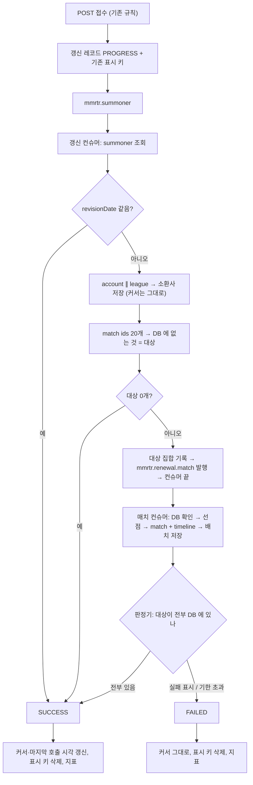

# 전적 갱신 완료 판정 (Plan 2 기반 작업)

- 작성일: 2026-11-03
- 범위: lol-repository (갱신 컨슈머 · 매치 처리 · 갱신 상태 API · 실험실 지표)
- 상태: 설계 (구현 전)
- 선행 문서: `2026-10-27-summoner-renewal-pipeline-design.md` (이하 "Plan 2 설계"), `2026-11-01-riot-api-lab-design.md` (이하 "실험실 설계")
- 표기: **[결정]** 은 사용자가 정한 것, **[판단]** 은 설계 작성자가 정한 것으로 빌더가 더 나은 근거가 있으면 바꿀 수 있다.

## 1. 왜 하나

### 지금 구조

- 갱신 상태는 Redis `summoner:renewal:{puuid}` 의 존재 여부 하나다. 갱신 컨슈머(`SummonerRenewalListener`)가 끝나면 finally 에서 지운다. 실패해도 지우므로 상태 GET 은 `SUCCESS` 를 돌려준다.
- `SummonerRenewalService.doRenew` 가 메시지 하나 안에서 summoner → account ∥ league → match ids → match·timeline ×N 을 모두 기다린다. 호출 하나만 실패해도 `join()` 예외로 아무것도 저장되지 않는다.
- 소환사는 Riot 의 새 revisionDate 로 저장되는데, 매치 DB 저장(`AsyncMatchSaver`)은 그 뒤에 비동기로 돈다. 비동기 저장이 실패하면 커서(DB revisionDate = 다음 갱신의 match ids `startTime`)는 이미 앞으로 가 있어 그 매치는 다시 조회되지 않는다.
- 중복 방지는 백필 경로만 한다. 발행 때 `match:pending:{id}`(SETNX, 10분), 소비 때 `match:processing:{id}`(SETNX, 30분, `MatchDataProcessor`). 갱신 경로(`MatchDataFetcher`)는 DB 만 본다. 그래서 같은 판에 있던 두 유저의 갱신, 또는 갱신과 백필이 같은 매치를 각자 Riot 에 요청한다.
- 매치 관련 INSERT 는 모두 `ON CONFLICT DO NOTHING` 이다. 중복 처리는 데이터 문제가 아니라 Riot 예산(매치당 asia 2회) 낭비다.
- `MatchDataProcessor` 는 실패(FAILURE)일 때 `match:processing` 을 풀지 않아 30분 동안 남는다.

### 바꾸는 이유

- 상태 GET 이 `SUCCESS` 를 돌려주는 순간은 **갱신해야 할 모든 것이 끝난 순간**이어야 한다. **[결정]**
- Plan 2(진행률 10/20/30/40, 접수 거절, 우선순위 큐)는 이 완료 판정 위에 올라간다. 매치 단계를 큐로 빼고 완료 판정을 먼저 만들어 두면, Plan 2 는 진행률과 접수 판단을 더하는 일이 된다.

## 2. 목표 · 비목표 · 안티목표

### 목표

- **G1. 상태 GET 의 `SUCCESS` 는 아래가 전부 끝났을 때만이다.** **[결정]**
  1. 소환사 조회 (revisionDate 비교)
  2. 계정 조회 → DB 저장
  3. 리그 조회 → DB 저장
  4. 매치 ID 조회 (최근 20개)
  5. 새 매치마다 매치 상세 + 타임라인 → DB 저장
  - revisionDate 가 같으면 1 에서 바로 `SUCCESS` 다.
- **G2. 하나라도 끝내 실패하거나 기한을 넘기면 `FAILED`, 진행 중이면 `PROGRESS` 다.** 상태 GET 은 이 셋을 돌려준다. **[결정]**
- **G3. 같은 매치를 Riot 에 두 번 요청하지 않는다.** 사용자 갱신끼리, 사용자 갱신과 백필·티어 수집 사이 모두. 방법은 "Riot 호출 전에 DB 와 Redis 를 확인한다". **[결정]** 예외 하나는 5.4 에 적는다.
- **G3-1. 접수된 갱신의 매치는 기한을 넘겨도 서버가 끝까지 처리한다.** 유저가 다시 눌렀을 때 결과가 보이게 하기 위해서다. Plan 2 설계 5.2-7 의 **[결정]** 을 그대로 따른다.
- **G4. 사용자 갱신 때문에 매치가 영구히 빠지지 않는다.**
- **G5. Plan 2 가 이 구조를 다시 만들지 않고 이어서 쓴다.**

### 비목표

- 진행률(10/20/30/40), 접수 거절(`BUSY`), 사용자 갱신 전용 summoner 큐, 타임라인 나중 받기. 모두 Plan 2 다. **[결정]**
- 20게임 이후 백필의 완료 판정. 백필은 `SUCCESS` 와 상관없이 BACKGROUND 로 계속 돈다. **[결정]**
- 티어 수집 같은 BACKGROUND 갱신을 큐로 옮기는 것. 지금처럼 메시지 하나 안에서 처리한다. 다만 처리 표시(5.4)는 같이 써서 사용자 갱신과 같은 매치를 두 번 부르지 않는다. **[판단]**
- lol-server · lol-ui 코드 변경.
- `MatchService.saveAll` 의 커넥션 hold-and-wait 수정 (실험실 PR #139 의 앱 문제 1). 사용자 경로의 저장은 배치 저장 한 스레드로 모여 동시 `saveAll` 이 줄어든다 (5.5). 실험실에서 재 보고 따로 판단한다. **[판단]**

### 안티목표 — 돌아가더라도 실패로 본다

- 대상 매치 중 하나라도 DB 에 없는데 `SUCCESS` 다.
- `PROGRESS` 에서 끝나지 않는 갱신이 있다.
- 사용자 갱신의 매치가 백필 뒤에 줄 선다 (큐에서든, 처리 표시에서든).
- 같은 판의 두 유저가 동시에 갱신했는데 같은 매치를 둘 다 Riot 에 요청한다.
- lol-server 가 깨지거나(WRONGTYPE 등), 배포된 lol-ui 가 깨진다.
- 메시지 재전달이나 인스턴스 여러 대 때문에 완료 지표가 두 번 세지거나, 끝난 상태가 `SUCCESS` ↔ `FAILED` 로 뒤집힌다.
- 지난 갱신의 메시지나 실패 표시가 새 갱신의 결과를 정한다 (예: 실패 직후 다시 눌렀는데 지난 실패 때문에 바로 `FAILED`).

## 3. 제약

- **lol-server 는 `summoner:renewal:{puuid}` 를 문자열로 읽는다** (`SummonerCacheAdapter.isUpdating`, `getRefreshingPuuids` 의 키 스캔). 키 이름·타입·값(puuid)을 바꾸지 않는다. lol-server 도 같은 키를 TTL 2분으로 만들고 같은 `mmrtr.summoner` 큐에 USER 메시지를 넣는다. lol-server 가 만든 메시지에는 갱신 id 가 없다.
- **새 키는 `summoner:renewal:*` 패턴 밖에 둔다.** lol-server `getRefreshingPuuids` 가 이 패턴을 SCAN 해 키 뒷부분을 puuid 로 읽는다. 지금은 부르는 곳이 없지만, 부르게 되면 `v2:...` 를 puuid 로 읽는다.
- **배포된 lol-ui:** POST `status == FAILED` 는 거절(쿨다운 문구), GET `status != PROGRESS` 는 끝(데이터 다시 불러오기)으로 읽는다. GET `FAILED` 도 구 UI 에서는 "끝" 으로 읽혀 데이터를 다시 불러온다. 깨지지 않는다.
- **컨텍스트 경계 (ArchUnit):** summoner 도메인은 match 도메인 port 에 의존하지 않는다. 매치 존재 확인이 필요한 완료 판정은 두 도메인에 이미 의존하는 `module:infra:rabbitmq` 에 둔다. 상태 GET 은 Redis 만 읽는다.
- **인스턴스가 여러 대일 수 있다.** 상태 전이는 Redis 에서 원자적으로 한다.
- **공개 API 규약** (`@PublicApi`, `ApiResponse<T>`, RestDocs). 응답 필드와 HTTP 코드는 바꾸지 않는다. GET `status` 값의 의미만 바뀐다.
- **Riot 호출은 #135 한도 관리자를 그대로 쓴다.** USER 는 10초 앞까지 칸을 예약하고, 못 잡으면 `RiotBudgetExceededException`. BACKGROUND 는 최대 30초 기다린다.
- **매치 목록 읽기 경로:** `MatchQueryService` 는 DB 결과에 요청자 캐시(`match:ids:v1:{puuid}`, `match:v1:{matchId}`, TTL 3분)를 덮어 보여 준다. 다른 워커가 처리한 매치는 요청자 캐시에 없으므로 DB 커밋 뒤에야 보인다.
- **검증:** `./gradlew check` 통과, 실험실 `lab.sh run steady` 판정에 FAIL 없음.

## 4. 전체 흐름

## 5. 설계

### 5.1 갱신 레코드 [판단]

- 새 키 Redis hash `summoner:renewal-v2:{puuid}`. Plan 2 설계 6.1 의 `summoner:renewal:v2:{puuid}` 를 3장 이유로 `renewal-v2` 로 바꾼다. Plan 2 는 여기에 `steps` 만 더한다.

  | 필드 | 내용 |
  |---|---|
  | `renewalId` | 갱신 하나를 가리키는 id (UUID). 메시지에도 싣는다 (5.2) |
  | `status` | `PROGRESS` / `SUCCESS` / `FAILED` |
  | `reason` | `FAILED` 일 때 이유. `lol.renewal.completed` 의 reason 과 같은 값 |
  | `acceptedAt` | 접수 시각(epoch ms). lol-server 가 넣은 메시지처럼 접수 기록이 없으면 컨슈머 시작 시각 |
  | `riotRevisionDate` | summoner-v4 의 revisionDate(ms). `SUCCESS` 때 커서로 쓴다 |
  | `matchPublishedAt` | 대상 매치를 발행한 시각. 이보다 앞선 실패 표시는 이 갱신의 판정에 쓰지 않는다 (5.6) |
  | `matchDeadlineAt` | `matchPublishedAt` + 기한 (5.6) |
  | `platform` | 플랫폼 |

- 대상 집합: Redis SET `summoner:renewal-v2:{puuid}:matches` (DB 에 없던 matchId).
- 진행 중 색인: ZSET `summoner:renewal-v2:active` (member = puuid, score = `matchDeadlineAt`). 판정기는 이것만 훑는다.
- TTL: `PROGRESS` 동안 5분이고 전이 때와 대상 발행 때 다시 건다. 기한(3분)보다 길어야 한다. 끝나면 30초만 남겨 마지막 폴링이 결과를 받게 한다 (Plan 2 설계 6.1 과 같은 값).
- 상태 전이는 Lua 로 "`status` 가 `PROGRESS` 이고 `renewalId` 가 내 것일 때만 바꾼다"(compare-and-set). 전이에 성공한 쪽만 뒷일(커서·지표·표시 키 삭제)을 한다. 그래서 인스턴스가 여러 대이거나, 메시지가 다시 오거나, 지난 갱신의 메시지가 늦게 와도 한 번만, 제 갱신에만 일어난다.
- **기존 표시 키 `summoner:renewal:{puuid}`:** 지금처럼 POST 에서 만든다(TTL 2분). 바뀌는 것은 두 가지다.
  - 지우는 시점이 "컨슈머 finally" 에서 "`SUCCESS`/`FAILED` 전이" 로 옮겨 간다. lol-server 가 보는 "갱신 중" 이 새 정의와 맞게 된다.
  - USER 갱신 컨슈머가 시작할 때(TTL 2분)와 대상을 발행할 때(TTL = 기한 + 30초) 같은 값으로 다시 건다. 매치 단계가 끝날 때까지 살아 있게 하려는 것이다.

### 5.2 접수 (POST) 와 상태 조회 (GET)

- POST 규칙은 그대로다 (`NOT_FOUND_PUUID`, 플랫폼 확인, 진행 중, 클릭 쿨다운 10초, 마지막 Riot 호출 후 2분).
- "진행 중" 판단 = 레코드 `status == PROGRESS` **또는** 기존 표시 키 있음. lol-server 가 시작한 갱신도 막기 위해서다. **[판단]**
- 접수하면 레코드(`PROGRESS`, 새 `renewalId`, `acceptedAt`) → 기존 표시 키 → 큐 발행 순으로 한다.
- `SummonerMessage` 에 선택 필드 `renewalId` 를 더해 싣는다. lol-server 는 이 필드를 보내지 않아도 된다 (없으면 null). **[판단]**
- GET 은 레코드가 있으면 그 `status` 를 돌려준다. 레코드가 없으면 기존 표시 키가 있을 때 `PROGRESS`, 없을 때 `SUCCESS`(지금과 같은 "진행 중인 갱신 없음")다. **[판단]**
- `RenewalStatus` 주석과 RestDocs 설명을 고친다: GET 도 `FAILED` 를 돌려줄 수 있다.

### 5.3 갱신 컨슈머 (USER 메시지)

- `mmrtr.summoner` 큐, 리스너, 소환사 분산 락은 그대로 쓴다. 메시지가 USER 일 때만 아래 흐름이고, BACKGROUND 는 지금 흐름에 처리 표시만 더한다 (5.4). **[판단]**
- **이 메시지가 어느 갱신인지 먼저 정한다. [판단]**

  | 메시지 | 레코드 | 처리 |
  |---|---|---|
  | `renewalId` 있음 | 같은 `renewalId` 이고 `PROGRESS` | 진행 |
  | `renewalId` 있음 | 그 밖 (없음, 다른 id, 끝남) | 지난 갱신의 메시지로 보고 버린다 (`skipped/stale`) |
  | `renewalId` 없음 (lol-server) | `PROGRESS` | 이미 다른 흐름이 처리 중이라 버린다 (`skipped/already_in_progress`) |
  | `renewalId` 없음 (lol-server) | 없음 또는 끝남 | 새 `renewalId` 로 레코드를 열고 진행 |

  lol-server 메시지가 끝난 뒤 다시 전달되면 새 갱신으로 한 번 더 돈다. 드물고, revisionDate 가 같아 summoner 조회 1회로 끝나므로 받아들인다.
- **락:** USER 는 소환사 락을 최대 10초 기다린다 (지금은 기다리지 않는다). 그래도 못 잡으면 `FAILED`(reason `lock_busy`). 전이는 `renewalId` 를 확인하므로 다른 갱신의 레코드를 끝내지 않는다. BACKGROUND 는 지금처럼 기다리지 않고 건너뛴다.
- **일찍 끝나는 경로는 모두 `FAILED` 다.** 지금은 그냥 return 해서 레코드가 5분 동안 `PROGRESS` 로 남는다.

  | 경로 | reason |
  |---|---|
  | 잘못된 platform | `other` |
  | summoner 조회 결과 없음 | `not_found` |
  | 계정·리그 조회 결과 없음 (`collectAndAssemble` 가 empty) | `not_found` (지금 지표는 success 로 센다) |

- 순서:
  1. 위 표로 갱신을 정하고 락을 잡는다. 기존 표시 키를 다시 건다 (5.1).
  2. summoner-v4 조회. revisionDate 가 같으면 `updateLastRiotCallDate` 후 `SUCCESS` 전이.
  3. account ∥ league 조회(`collectAndAssemble`) 후 소환사 저장. **단 revisionDate 와 lastRiotCallDate 는 DB 값을 유지한다** (5.7 에서 옮긴다). Riot 의 revisionDate 는 레코드 `riotRevisionDate` 에 둔다.
  4. match ids 조회 (`startTime` = DB revisionDate, `count` = 20). DB 에 없는 것이 대상이다. 5.7 의 "계속 실패하는 매치" 는 대상에서 뺀다.
  5. 대상이 0개면 `SUCCESS` 전이.
  6. 대상 집합 → `matchPublishedAt`·`matchDeadlineAt` → active 색인 순으로 기록한 **뒤에** `mmrtr.renewal.match` 로 발행한다. 순서가 반대면 판정기가 빈 집합을 보고 `SUCCESS` 로 넘길 수 있다.
  7. 20개를 꽉 채웠으면 지금처럼 백필 요청을 발행한다 (#130 전에는 소비자 없음).
  8. 예외가 나면 `FAILED` 전이 (reason = `RenewalFailureReason.of(e)`).
- USER 경로의 finally 에서는 기존 표시 키를 지우지 않는다. 락은 지금처럼 푼다.
- 컨슈머는 매치를 기다리지 않으므로, 메시지 하나가 컨슈머 스레드를 잡는 시간이 match ids 조회까지로 줄어든다.
- 같은 puuid 의 USER 레코드가 `PROGRESS` 인데 BACKGROUND 메시지가 오면 건너뛴다 (지표 `skipped/user_in_progress`). BACKGROUND 경로가 커서를 먼저 옮기지 않게 하려는 것이다. **[판단]**

### 5.4 사용자 매치 큐와 중복 방지

**큐 — 전용 큐를 만든다. [판단]**

- 큐 `mmrtr.renewal.match`, 전용 exchange, DLX `mmrtr.renewal.match.dlx`.
- 메시지 형식은 기존 `mmrtr.matchId` 와 같다 (본문 matchId, 헤더 `region`). 요청자 캐시를 쓰기 위해 헤더 `requester`(요청자 puuid)를 더한다.
- 기존 큐를 쓰지 않는 이유:
  - 기존 큐는 백필(소환사당 최대 1000개)·티어 수집과 FIFO 로 줄을 같이 선다. 한도 관리자가 USER 를 먼저 내보내도 메시지가 큐 뒤쪽에 묶여 있으면 소용없다.
  - `x-max-priority` 는 선언 뒤에 바꿀 수 없다. 기존 큐를 우선순위 큐로 바꾸려면 환경마다 지우고 다시 만들어야 한다.
  - 전용 큐의 깊이가 곧 사용자 몫의 밀린 양이다. Plan 2 접수 판단에 그대로 쓴다.
- 컨슈머: prefetch 1, 수동 ack, 동시 수는 설정값(시작값 20). 처리기는 기존 `MatchDataProcessor` 를 우선순위 인자를 받게 고쳐 두 큐가 같이 쓴다.

**매치 하나 처리 — 두 큐 공통. 순서가 중요하다.**

1. **DB 에 있으면 `DUPLICATE`** (ack). 발행 뒤에 다른 경로가 저장했을 수 있다. **[결정]**
2. **처리 표시를 선점한다** — `match:processing:{id}`. 읽고 나서 쓰는 게 아니라 원자적으로 잡는다. 두 워커가 동시에 "없음" 을 읽으면 둘 다 호출하기 때문이다. **[결정 + 판단]**
   - 값에 우선순위를 적는다 (`USER` / `BACKGROUND`).
   - BACKGROUND: 키가 없을 때만 잡는다 (SETNX, 지금과 같다).
   - USER: 키가 없거나 값이 `BACKGROUND` 면 `USER` 로 덮어쓴다 (Lua). 값이 `USER` 면 `DUPLICATE`.
   - 표시를 풀 때는 값이 내 것일 때만 지운다 (Lua). USER 가 덮어쓴 표시를 늦게 끝난 BACKGROUND 가 지우지 않게 하려는 것이다.
   - **G3 의 예외:** USER 가 BACKGROUND 표시를 덮어쓰면 그 매치는 두 번 호출된다(asia 2회). 백필 워커가 BACKGROUND 한도 대기(최대 30초) 중에 표시를 쥐고 있으면 사용자 갱신이 그만큼 기다리므로, 이 경우만 중복을 받아들인다. DB 에는 `ON CONFLICT` 로 하나만 남는다. **[판단]**
3. **match ∥ timeline 호출** (메시지의 우선순위로).
4. **결과 처리:**

   | 결과 | 처리 |
   |---|---|
   | 성공 | 배치 저장 큐에 넣는다. USER 면 요청자 캐시도 쓴다. 처리 표시 TTL 을 60초로 줄인다 (저장 전에 죽어도 30분 묶이지 않게) |
   | 한도 초과 · 시간 초과 · 배치 큐 가득 | 표시를 풀고 requeue (지금과 같음) |
   | 실패 (재시도 소진, 4xx 등) | 표시가 아직 내 것일 때만(Lua) 실패를 남긴다. USER 실패면 `match:failed:{id}`(값 = 실패 시각, TTL 5분)와 실패 횟수를 남긴다. BACKGROUND 실패는 판정에 쓰지 않으므로 표시만 푼다. 그다음 DLX 로 보낸다 |

   - 실패 표시를 USER 실패로만 남기는 이유: BACKGROUND 실패 뒤에도 같은 매치의 USER 메시지가 아직 큐에 있으면 성공할 수 있다.
   - "표시가 내 것일 때만" 인 이유: USER 가 덮어쓴 뒤 늦게 실패한 BACKGROUND 가 사용자 갱신을 `FAILED` 로 만들지 않게 하려는 것이다.

**남은 메시지는 끝까지 처리한다 (G3-1).** 갱신이 기한으로 `FAILED` 가 돼도 `mmrtr.renewal.match` 의 메시지를 버리거나 백필 큐로 내리지 않는다. 그 매치를 다른 갱신이 기다리고 있을 수 있기 때문이다. A 가 표시를 쥔 동안 B 의 메시지가 `DUPLICATE` 로 처리됐다면 B 는 A 의 메시지에 기대고 있다. 그래서 큐 깊이는 실제로 앞에 쌓인 일의 양이고, Plan 2 접수 판단에 그대로 쓸 수 있다.

**티어 수집(BACKGROUND 갱신)의 매치 조회. [판단]** 큐로 옮기지 않고 메시지 하나 안에서 처리하되, 매치마다 위 1·2단계를 거친다.
- DB 에 있거나 표시를 못 잡은 매치는 부르지 않는다.
- 결과 처리는 위 표의 BACKGROUND 규칙을 따른다.
- 건너뛴 매치는 다른 흐름이 저장한다. 그 흐름이 실패하면 그 매치는 다음 갱신(누구의 것이든)에서 다시 들어온다. 매치는 참가자 10명이 같이 쓰는 한 행이다.

**발행 쪽 (사용자 갱신). [판단]**

- DB 에 없는 대상은 `match:pending` 을 보지 않고 전부 사용자 큐에 발행한다. pending 을 보고 건너뛰면 그 매치가 백필 큐 뒤에서 차례를 기다리는 동안 유저도 기다린다.
- 늦게 도착한 백필 메시지는 위 1·2 단계에서 `DUPLICATE` 로 버려진다.
- 다른 사용자 갱신이 같은 매치를 처리 중이어도 발행은 한다. 소비 쪽 2단계가 `DUPLICATE` 로 걸러 내고, 두 갱신 모두 그 매치가 DB 에 들어간 순간 함께 끝난다 (5.6).

### 5.5 배치 저장 [판단]

- 사용자 경로의 매치 저장은 `MatchBatchProcessor`(1초 주기 flush, 한 스레드)로 모인다. 사용자 경로의 `AsyncMatchSaver` 호출은 없어진다 (BACKGROUND 갱신은 그대로).
- 사용자 몫을 따로 둔다. 백필이 메모리 큐(500)를 채워도 사용자 매치가 `QUEUE_FULL` 로 밀리지 않도록 USER 전용 메모리 큐를 두고 flush 때 먼저 비운다.
- flush 의 `saveAll` 은 1초보다 오래 걸릴 수 있다. 판정기는 flush 와 같은 스케줄러 스레드를 쓰지 않는다 (지금 `@Scheduled` 는 기본 단일 스레드).

### 5.6 완료 판정기 [판단]

- `module:infra:rabbitmq` 에 둔다 (매치 DB 확인과 소환사 갱신이 둘 다 필요하다 — 3장 경계).
- 500ms 마다 active 색인을 훑는다. 모든 인스턴스가 돌아도 된다 (전이는 CAS).
- 활성 갱신 전체의 대상 matchId 를 모아 `findExistingMatchIds` 로 한 번에 조회한다.
- 대상 매치 하나의 상태:

  | 상태 | 읽는 법 |
  |---|---|
  | 끝남 | DB 에 있음 |
  | 실패 | `match:failed:{id}` 가 있고, 그 값(실패 시각)이 이 갱신의 `matchPublishedAt` 이후 |
  | 대기·처리 중 | 그 밖 |

  실패 시각을 비교하는 이유: 실패 직후 다시 눌렀을 때, 지난 갱신이 남긴 실패 표시(TTL 5분) 때문에 새 갱신이 바로 `FAILED` 가 되지 않게 하려는 것이다. 새 갱신의 메시지는 그 매치를 다시 시도한다.

- 갱신 하나의 판정:
  - 대상이 전부 끝남 → `SUCCESS`
  - 하나라도 실패 → `FAILED` (reason `match_failed`)
  - 지금 > `matchDeadlineAt` → `FAILED` (reason `deadline`)
  - 그 밖 → 그대로 둔다
- **기한은 대상 발행부터 3분이다** (설정값). 성능 기준이 아니라 "일이 사라졌다"(메시지 유실, 프로세스 종료 등)를 잡는 안전망이다. 서버는 기한을 넘긴 매치도 끝까지 처리하고(G3-1), `SUCCESS` 는 "모두 끝났을 때" 이므로 느린 갱신을 실패로 만들지 않으려고 넉넉히 둔다. Plan 2 의 "3초 안에 40" 은 기한이 아니라 접수 거절로 지킨다.
- 판정이 DB 커밋 기준이므로 `SUCCESS` 는 저장 flush(≤1초) + `saveAll` 시간 + 판정 주기(≤0.5초) 뒤에 온다.

### 5.7 끝낼 때 — 전이에 성공한 쪽만 한다

- **`SUCCESS`:**
  - 소환사 revisionDate = 레코드의 `riotRevisionDate`, lastRiotCallDate = 지금. (revisionDate 가 같았던 경우는 lastRiotCallDate 만.)
  - 기존 표시 키 삭제, active 색인에서 제거, 레코드 TTL 30초.
  - 지표 `lol.renewal.completed{result=success, reason=none, priority=user}`, 소요 시간 `lol.renewal.duration{result}` (`acceptedAt` 부터).
- **`FAILED`:**
  - 커서와 lastRiotCallDate 는 그대로 둔다. 다음 갱신이 같은 구간을 다시 보고, 이미 저장된 매치는 건너뛴다.
  - 그래서 실패 직후에도 클릭 쿨다운(10초)만 지나면 다시 누를 수 있다. 지금 실패했을 때와 같은 동작이다.
  - 기존 표시 키 삭제, active 색인에서 제거, 레코드 TTL 30초, 지표 `failed/<reason>`.
- **계속 실패하는 매치:** 같은 matchId 가 3번 실패하면(`match:failed-count:{id}`, TTL 1일) 다음 갱신부터 대상에서 뺀다. 빼지 않으면 그 유저의 갱신은 매번 `FAILED` 다. 뺀 매치는 로그와 지표(`lol.renewal.match_excluded`)로 남긴다. **[판단]**

### 5.8 지표 · 실험실

- `lol.renewal.completed` 는 USER 경로에서 "모두 끝났을 때" 한 번 센다 (지금은 컨슈머가 끝날 때). BACKGROUND 는 지금 그대로다. 더해지는 값:
  - failed reason: `match_failed`, `deadline`, `not_found`, `lock_busy`
  - skipped reason: `stale`, `already_in_progress`, `user_in_progress`
- 새 지표:
  - `lol.renewal.duration{result}` — 접수부터 끝까지 (timer)
  - `lol.renewal.active` — 진행 중 갱신 수 (gauge)
  - `lol.match.process{result=success|duplicate|failure|requeue, priority}` — 매치 처리 결과
- 실험실:
  - `verify` 에 END 시점 `mmrtr.renewal.match` 큐 깊이와 `lol.renewal.duration` p95 를 WARN/INFO 로 더한다 (실험실 설계의 "처리 항목은 FAIL 로 치지 않는다" 규칙을 그대로 따른다).
  - Grafana 에 같은 패널을 더한다.
  - k6 는 GET `status != PROGRESS` 를 끝으로 보므로 바꿀 필요가 없다 (`FAILED` 도 끝).
- 완료 기준: `lab.sh run steady` FAIL 0. 결과를 #139 기준선(`timeout=2769`, 갱신 끝남 p95 10.02s)과 나란히 PR 에 적는다.

## 6. Plan 2 설계에서 바뀌는 곳

| Plan 2 설계 | 이 작업 이후 |
|---|---|
| 6.1 `remainingMatches` 카운터 + Lua + "이번 갱신에서 처리한 matchId" 집합 | 대상 집합 + DB 상태 판정(5.6). 카운터는 다른 갱신이 처리한 매치를 줄이지 못한다. Plan 2 는 레코드에 `steps` 비트만 더하고, 매치 비트는 이 판정의 "전부 끝남" 이다 |
| 6.1 키 `summoner:renewal:v2:{puuid}` | `summoner:renewal-v2:{puuid}` (lol-server SCAN 패턴 밖, 3장) |
| 6.10 사용자 갱신 새 메시지에 "갱신 id" | `SummonerMessage.renewalId` 로 먼저 들어온다(5.2). Plan 2 의 새 큐도 같은 id 를 쓴다 |
| 6.2 매치 단계 완료 = 매치 목록 캐시에 쓴 뒤 | DB 커밋 뒤. 다른 워커가 처리한 매치는 요청자 캐시에 없다 |
| 6.5 match 큐 우선순위 1 | `mmrtr.renewal.match` 가 우선순위 1 큐다. 우선순위 2(나중 타임라인)는 Plan 2 가 더한다 |
| 6.7 GET `FAILED` → 구 `status` 는 `SUCCESS` | 구 `status` 도 `FAILED` 다 **[결정]**. 구 UI 는 `!= PROGRESS` 를 끝으로 보므로 깨지지 않는다. Plan 2 는 `state`·`progress` 만 더한다 |
| (없음) 커서 | revisionDate 는 `SUCCESS` 때 옮긴다(5.7). Plan 2 도 그대로 따른다 |
| 6.9 단계 실패 | `FAILED` 의 이유와 기한은 5.6·5.7 을 따른다 |

## 7. Plan 2 진입 조건

- **머지 순서:** #136 → #135 → #139 → 이 작업. 이 작업 브랜치는 #139(`feat/riot-api-lab`)에서 딴다. 실험실로 전후를 비교하기 위해서다.
- **#130 (백필 리스너 켜기):** 이 작업은 `MatchDataProcessor` 를 고치고 #130 은 `MatchListener`·`MatchFindListener` 의 `@RabbitListener` 를 켠다. 겹치는 파일은 `MatchListener` 하나라 어느 쪽이 먼저 머지돼도 충돌은 작다. Plan 2 의 우선순위 3(백필)은 #130 이 있어야 하므로 Plan 2 시작 전에는 머지돼 있어야 한다.
- **기준선:** 이 작업 뒤의 `lab.sh run steady` 결과가 Plan 2 의 비교 기준이다.
- **Plan 2 에 넘기는 것:** 갱신 레코드(5.1), 사용자 매치 큐(5.4), 완료 판정기(5.6).
- **Plan 2 가 할 일:** 진행률 비트, 접수 거절, 사용자 갱신 전용 summoner 큐, 타임라인 나중 받기, lol-ui.

## 8. 알려진 한계

- 과부하(실험실 steady 10건/초는 asia 수요가 예산의 2배를 넘는다)에서는 summoner 큐와 사용자 매치 큐가 계속 자란다.
  - 갱신이 몇 분씩 `PROGRESS` 로 남고, 매치 단계가 3분을 넘기면 `deadline` 으로 `FAILED` 가 된다. 그래도 매치는 끝까지 저장된다.
  - 레코드 TTL 5분 안에 컨슈머가 시작하지 못하면 레코드가 사라져 GET 이 `SUCCESS` 로 돌아가고, 늦게 온 메시지는 `stale` 로 버려진다. 지금도 있는 문제이고 Plan 2 접수 거절이 막는다.
- USER 가 BACKGROUND 처리 표시를 덮어쓰면 그 매치는 두 번 호출된다 (5.4).
- 배치 저장 전에 프로세스가 죽으면 그 매치는 저장되지 않는다. 그 갱신은 기한에 `FAILED` 가 되고, 커서가 그대로라 다음 갱신이 다시 가져온다 (처리 표시 TTL 60초 뒤).

## 9. 빌더에게 맡기는 것

- 클래스·패키지 이름, Lua 스크립트 모양, 설정 키 이름.
- 판정 주기(500ms)·기한(3분)·처리 표시 TTL(60초)·실패 횟수(3번)·USER 락 대기(10초)의 기본값 미세 조정.
- 사용자 매치 큐의 동시 수.
- 대상 집합을 SET 으로 둘지 hash 필드로 둘지.
- `SummonerAssembler` 가 DB revisionInfo 를 유지하게 하는 방법 (조립 인자 추가 / 저장 전 덮어쓰기).
- 테스트 구성. 기존 패턴(컨슈머·처리기 단위 테스트, Testcontainers Redis·RabbitMQ)을 따른다.
